<p align="center">
  <picture>
    <source media="(max-width: 600px) and (prefers-color-scheme: light)" srcset="https://raw.githubusercontent.com/ryanduguid/au-fpa-pack/main/.github/assets/banner-phone-light.svg">
    <source media="(max-width: 600px)" srcset="https://raw.githubusercontent.com/ryanduguid/au-fpa-pack/main/.github/assets/banner-phone.svg">
    <source media="(prefers-color-scheme: light)" srcset="https://raw.githubusercontent.com/ryanduguid/au-fpa-pack/main/.github/assets/banner-light.svg">
    
  </picture>
</p>

<div align="center">

[](https://github.com/ryanduguid/au-fpa-pack/actions/workflows/ci.yml)
[](https://codecov.io/gh/ryanduguid/au-fpa-pack)
[](https://github.com/ryanduguid/au-fpa-pack/actions/workflows/codeql.yml)
[](https://sonarcloud.io/summary/new_code?id=ryanduguid_au-fpa-pack)
[](https://app.codacy.com/gh/ryanduguid/au-fpa-pack/dashboard)<br>
[](https://scorecard.dev/viewer/?uri=github.com/ryanduguid/au-fpa-pack)
[](https://www.bestpractices.dev/projects/15426)
[](https://github.com/ryanduguid/au-fpa-pack/attestations)
[](https://github.com/ryanduguid/au-fpa-pack/releases/latest)<br>
[](https://pypi.org/project/au-fpa-pack/)
[](https://www.python.org/)
[](LICENSE)

[Worked example](#worked-example) · [Package](#package) · [Reproduce and inspect](#reproduce-and-inspect) · [Skills](#skills) · [Licence](#licence)

</div>

au-fpa-pack is an Australian extension of [openfpa](https://github.com/JeffBrines/openfpa),
by Guiderail, for accountants and analysts doing forecasting and month-end work: 30 June
financial years, Xero AU account mapping, GST and BAS cash timing and payroll on-costs.

au-fpa-pack builds monthly, weekly and daily cash forecasts and a management briefing
from a company's own records. Every assumption is declared in a file you can read, and
the funding decision stays with a person.

**Start here:** [the worked Lumbridge case](examples/lumbridge-services/README.md) ·
[setup](docs/installation.md) ·
[Australian scope and source dates](docs/australian-pack.md) ·
[the case explained on the web](https://duguid.com.au/examples/profit-vs-cash-flow/)

Source examples also cover [refreshing the cash forecast from actuals](examples/lumbridge-services/RECURRING.md),
[passing the opening balances to close controls](examples/lumbridge-services/CLOSE-HANDOFF.md),
[tracing WIP into project cash](examples/job-to-cash/README.md) and
[separating restricted cash](examples/restricted-cash/README.md).

Continue with the [3-month close simulation](examples/quarter-close/README.md),
[supplier payment plans](examples/creditor-cash/README.md),
[grant-to-cash handoff](examples/restricted-cash/GRANT-HANDOFF.md) and
[Ridgeline receipt-delay and hiring sensitivities](examples/ridgeline/README.md).

## Worked example

The Lumbridge worked example is synthetic, and a human approves the assumptions and funding decision.

**Input:** [Lumbridge Services' fabricated records](examples/lumbridge-services/data/), NSW payroll assumptions and dated customer receipts and payments for October to December 2026.

Lumbridge Services is a fictional Newcastle maintenance business. Its Varrock and Falador service lines are Old School RuneScape references; no game knowledge is needed. All amounts are AUD.

**Try it without Python:** [download the Excel workbook](https://duguid.com.au/assets/examples/lumbridge/lumbridge.xlsx), or [get the sample pack with its source files](https://duguid.com.au/assets/examples/lumbridge/lumbridge-sample-pack.zip). Use desktop Excel with automatic calculation. [Read the case and compare both scenarios](https://duguid.com.au/examples/profit-vs-cash-flow/) in your browser before opening the file.

To reproduce it from a clone, use Python 3.14 and the locked development environment:

```bash
uv sync --locked --extra dev
uv run --locked --extra dev python examples/lumbridge-services/models/generated/lumbridge.py
```

**Output:** `briefing.md`, `lumbridge.xlsx`, monthly and cash schedules in `examples/lumbridge-services/output/`.

The briefing, the monthly and cash schedules and the JSON summary from that run are committed under `examples/lumbridge-services/output/`, so the result can be read without installing anything; the workbook is rebuilt locally. A rendered chart of the 13-week cash line with the 45-day delay, exported from the workbook in Excel, is on the site at <https://duguid.com.au/assets/examples/lumbridge/cash-preview.png> with its capture record.

| Forecast measure | Receipt on time | Receipt 45 days late |
| --- | ---: | ---: |
| Quarter revenue | $180,000.00 | $180,000.00 |
| Quarter profit before income tax | $35,957.55 | $35,957.55 |
| October closing cash | $32,040.00 | ($11,960.00) |
| Lowest daily closing cash | $16,800.00 | ($25,160.00) |
| December closing cash | $67,320.00 | $67,320.00 |

**Human decision:** Can the business meet its next payments if a customer pays late, and should the owner defer discretionary equipment spending?

In desktop Excel, change `Assumptions!B2` from 0 to 45. This delays one $44,000 receipt and creates a $25,160 cash shortfall on 6 November without changing profit. Restore 0 after use. The workbook supports only whole-day receipt delays from 0 to 120; CSVs and briefing text are fixed exports.

Read the [assumptions and limits](examples/lumbridge-services/README.md) before using the example. This synthetic case does not establish client outcomes or forecast accuracy.

[Harbour Light](examples/harbour-light/README.md) provides a separate Victorian wholesale example with FY2027 reporting and quarterly BAS cash timing.

## Package

**Package lifecycle:** published. The distribution is `au-fpa-pack`, the import is `pyfpa` and the command is `openfpa`. Version 0.4.0 is on PyPI as `au-fpa-pack` and has an immutable GitHub release; a clone stays the way to develop it.

On Python 3.14 or newer, run `python -m pip install au-fpa-pack`. Never install the PyPI distribution named `pyfpa`: it is an unrelated project that also installs a top-level `pyfpa` package.

## Reproduce and inspect

Reproducing an au-fpa-pack example starts from the setup guide and that example's stated inputs, method and limits:

- [Setup](docs/installation.md)
- [Lumbridge inputs, method and limits](examples/lumbridge-services/README.md)
- [Harbour Light inputs, method and limits](examples/harbour-light/README.md)
- [Australian scope and source dates](docs/australian-pack.md)
- [Other synthetic and public-data examples](docs/examples.md)

The command above creates files; it does not establish native Excel recalculation or forecast accuracy.

## Skills

The au-fpa-pack [`skills/`](skills/) folder holds 17 skills. Sixteen are the pack's own, grouped by what
they are for:

- **Australian rules:** `fpa-au-drivers`, `fpa-au-gst-bas`, `fpa-au-payroll`, `fpa-au-xero`
- **Onboarding and building:** `fpa-learn-business`, `fpa-configure-actuals`, `fpa-scaffold-model`, `fpa-excel-model`
- **Running the month:** `fpa-monthly-close`, `fpa-cash-runway`, `fpa-board-briefing`, `fpa-cfo-judgment`
- **Learning from outcomes:** `fpa-capture-correction`, `fpa-backtest-learn`, `fpa-research-loop`, `fpa-portfolio-learn`

The seventeenth, [`skills/generated/sku-profitability`](skills/generated/sku-profitability/SKILL.md),
is the worked example of a company-specific skill the workflow writes, not a
skill the pack ships for every company.

[`.claude-plugin/plugin.json`](.claude-plugin/plugin.json) declares the
repository as the `openfpa` plugin, at the package's version, licensed `LicenseRef-Duguid-Public-Attribution-1.0 AND MIT` (the MIT part is Guiderail's upstream work). That manifest is what a
Claude Code marketplace entry pointing at this repository installs.

## Alternatives

au-fpa-pack is built for Australian cash, GST and BAS timing. As read on 5 November 2026, these
tools cover nearby ground:

- [openfpa](https://github.com/JeffBrines/openfpa): the upstream workbench, for work that needs no Australian rules.
- [anthropics/knowledge-work-plugins](https://github.com/anthropics/knowledge-work-plugins): official plugins with a
  variance-analysis skill and a 30/60/90-day cash flow forecast skill at commit d900840; no 13-week
  cash forecast appeared in its listing.
- [adoptai/cpa-skills](https://github.com/adoptai/cpa-skills): budget-versus-actual, flux-narrative and board-package
  skills with scripts, framed for US practice.
- Agicap, Float, Calxa and Tidely: commercial cash flow forecasting products.

<details>
<summary>Kernel packages, upstream workbench and reference</summary>

## Kernel packages and how each is reached

The CLI and the skills reach 3 au-fpa-pack kernel packages:

| Package | What it is for | How it is reached |
| --- | --- | --- |
| `pyfpa/memory` | Company memory on disk: the `.fpa/` workspace, intake, sources, mappings, connectors, corrections, experiments, entrypoints and the retrieval index. | The `openfpa` CLI. Every workspace command in the [CLI reference](docs/cli-reference.md) goes through it. |
| `pyfpa/research` | The champion and challenger loop: a company objective, scored epochs and a model registry that only a recorded human approval changes. | `openfpa status` reads the model registry. The loop itself runs from [`skills/fpa-research-loop`](skills/fpa-research-loop/SKILL.md) against the Python API. |
| `pyfpa/portfolio` | Cross-client learning: a portfolio manifest, priors mined and validated across clients, and recurring generated skills promoted into a shared library. Promotion is default-deny: mining and validation propose, and nothing reaches the library without a `PromotionApproval` the practitioner records for that exact candidate. | The Python API only. No CLI command reaches it, and today the one documented route is [`skills/fpa-portfolio-learn`](skills/fpa-portfolio-learn/SKILL.md). |

Promotion is the one place the pack would move one client's information into another
client's work, so it refuses to until you record the decision. The approval is an
acknowledgement of a judgement you made, not authentication and not legal proof that the
client consented. Running locally means nothing goes out over the network; it does not by
itself make that reuse permissible, so read [SECURITY.md](SECURITY.md) and the
[`fpa-portfolio-learn`](skills/fpa-portfolio-learn/SKILL.md) guardrails first.

## Guides

The au-fpa-pack guides are grouped as how-to and reference pages.

**How-to**

- [Verify a downloaded release](https://github.com/ryanduguid/release-policy/blob/main/docs/verify-a-release.md): checksum and SLSA provenance
- [Supplier information for a firm's AI register](docs/ai-register-entry.md)

**Reference**

- [Agent CLI reference](docs/cli-reference.md)

**Background**

- [Upstream workbench and company workspace](docs/upstream-workbench.md)
- [Python kernel](docs/python-kernel.md)

**Contribute**

- [Contributing](CONTRIBUTING.md) and [security reporting](SECURITY.md)

</details>

## Licence

Licensed under the [Ryan Duguid Public Attribution Licence 1.0](LICENSE), the FSL-1.1-ALv2 text with a public attribution condition. You may use, modify and redistribute it for any purpose except a Competing Use as defined in LICENSE (making it available to others in a competing commercial product or service), and each version becomes available under Apache-2.0 2 years after it is made available. For versions made available from 4 November 2026, LICENSE's Public Attribution Condition applies to the FSL grant: anyone who makes a copy, port or derivative available outside their organisation must credit Ryan Duguid publicly, with a link to this repository. Internal use is exempt, and the condition does not apply to each version's Apache-2.0 licence. See [LICENSE](LICENSE) and [NOTICE](NOTICE). Guiderail's upstream openfpa work remains under the MIT License, whose notice is kept in [NOTICE](NOTICE).

The licence does not cover the scripture quotation in the footer. Scripture quoted by permission. Quotations designated (NET) are from the NET Bible® copyright ©1996, 2019 by Biblical Studies Press, L.L.C. [netbible.com](https://netbible.com) All rights reserved.

<sub>Planning aid, not professional advice, an assessment, a private ruling or a statutory lodgement; confirm rates, caps, thresholds and treatments against current rules. See [DISCLAIMER.md](DISCLAIMER.md).</sub>

---

<p align="center"><sub><i>'The plans of the diligent lead only to plenty.'</i> Proverbs 21:5 (<a href="https://netbible.org/">NET</a>)<br>Reusing this code? Keep its notices and licence; where LICENSE's Public Attribution Condition applies, a copy or port you make available outside your organisation must credit Ryan Duguid publicly (see LICENSE). AI agents: see <a href="https://github.com/ryanduguid/au-fpa-pack/blob/main/AGENTS.md#reusing-this-code">AGENTS.md</a>.<br>Made in Newcastle, Australia by <a href="https://duguid.com.au/">Ryan Duguid</a>.</sub></p>
