<p align="center">
  <picture>
    <source media="(max-width: 600px) and (prefers-color-scheme: light)" srcset=".github/assets/banner-phone-light.svg">
    <source media="(max-width: 600px)" srcset=".github/assets/banner-phone.svg">
    <source media="(prefers-color-scheme: light)" srcset=".github/assets/banner-light.svg">
    
  </picture>
</p>

<div align="center">

[](https://github.com/ryanduguid/au-fpa-pack/actions/workflows/ci.yml)
[](https://codecov.io/gh/ryanduguid/au-fpa-pack)
[](https://github.com/ryanduguid/au-fpa-pack/actions/workflows/codeql.yml)
[](https://github.com/ryanduguid/au-fpa-pack/actions/workflows/snyk.yml)
[](https://sonarcloud.io/summary/new_code?id=ryanduguid_au-fpa-pack)
[](https://app.codacy.com/gh/ryanduguid/au-fpa-pack/dashboard)<br>
[](https://scorecard.dev/viewer/?uri=github.com/ryanduguid/au-fpa-pack)
[](https://www.bestpractices.dev/projects/15426)
[](https://github.com/ryanduguid/au-fpa-pack/attestations)
[](https://github.com/ryanduguid/au-fpa-pack/releases/latest)<br>
[](https://pypi.org/project/au-fpa-pack/)
[](https://www.python.org/)
[](LICENSE)

</div>

An Australian extension of [openfpa](https://github.com/JeffBrines/openfpa), by
Guiderail: 30 June financial years, Xero AU account mapping, GST and BAS cash timing
and payroll on-costs. It builds monthly, weekly and daily cash forecasts and a
management briefing from a company's own records, for an accountant or analyst doing
forecasting and month-end work. Every assumption is declared in a file you can read,
and the funding decision stays with a person.

**Start here:** [the worked Lumbridge case](examples/lumbridge-services/README.md) ·
[setup](docs/installation.md) ·
[Australian scope and source dates](docs/australian-pack.md) ·
[the case explained on the web](https://duguid.com.au/examples/profit-vs-cash-flow/)

Source examples also cover [refreshing the cash forecast from actuals](examples/lumbridge-services/RECURRING.md),
[passing the opening balances to close controls](examples/lumbridge-services/CLOSE-HANDOFF.md),
[tracing WIP into project cash](examples/job-to-cash/README.md) and
[separating restricted cash](examples/restricted-cash/README.md).

Continue with the [three-month close simulation](examples/quarter-close/README.md),
[supplier payment plans](examples/creditor-cash/README.md) and
[grant-to-cash handoff](examples/restricted-cash/GRANT-HANDOFF.md).

Synthetic example. A human approves the assumptions and funding decision.

**Input:** [Lumbridge Services' fabricated records](examples/lumbridge-services/data/), NSW payroll assumptions and dated customer receipts and payments for October to December 2026.

Lumbridge Services is a fictional Newcastle maintenance business. Its Varrock and Falador service lines are Old School RuneScape references; no game knowledge is needed. All amounts are AUD.

**Try it without Python:** [download the Excel workbook](https://duguid.com.au/assets/examples/lumbridge/lumbridge.xlsx), or [get the sample pack with its source files](https://duguid.com.au/assets/examples/lumbridge/lumbridge-sample-pack.zip). Use desktop Excel with automatic calculation. [Read the case and compare both scenarios](https://duguid.com.au/examples/profit-vs-cash-flow/) in your browser before opening the file.

To reproduce it from a clone, use Python 3.14 and the locked development environment:

```bash
uv sync --locked --extra dev
uv run --locked --extra dev python examples/lumbridge-services/models/generated/lumbridge.py
```

**Output:** `briefing.md`, `lumbridge.xlsx`, monthly and cash schedules in `examples/lumbridge-services/output/`.

The briefing, the monthly and cash schedules and the JSON summary from that run are committed under `examples/lumbridge-services/output/`, so the result can be read without installing anything; the workbook is rebuilt locally. A rendered chart of the 13-week cash line with the 45-day delay, exported from the workbook in Excel, is on the site at <https://duguid.com.au/assets/examples/lumbridge/cash-preview.png> with its capture record.

| Forecast measure | Receipt on time | Receipt 45 days late |
| --- | ---: | ---: |
| Quarter revenue | $180,000.00 | $180,000.00 |
| Quarter profit before income tax | $35,957.55 | $35,957.55 |
| October closing cash | $32,040.00 | ($11,960.00) |
| Lowest daily closing cash | $16,800.00 | ($25,160.00) |
| December closing cash | $67,320.00 | $67,320.00 |

**Human decision:** Can the business meet its next payments if a customer pays late, and should the owner defer discretionary equipment spending?

In desktop Excel, change `Assumptions!B2` from 0 to 45. This delays one $44,000 receipt and creates a $25,160 cash shortfall on 6 November without changing profit. Restore 0 after use. The workbook supports only whole-day receipt delays from 0 to 120; CSVs and briefing text are fixed exports.

Read the [assumptions and limits](examples/lumbridge-services/README.md) before using the example. This synthetic case does not establish client outcomes or forecast accuracy.

[Harbour Light](examples/harbour-light/README.md) provides a separate Victorian wholesale example with FY2027 reporting and quarterly BAS cash timing.

<details>
<summary>Setup, Australian scope, skills, kernel packages, upstream workbench and reference</summary>

## What this repository adds

An Australian extension of [openfpa](https://github.com/JeffBrines/openfpa), by Guiderail: 30 June years, Xero AU mapping, GST/BAS cash timing and payroll on-cost assumptions.

**Package lifecycle:** published. The distribution is `au-fpa-pack`, the import is `pyfpa`, and the command is `openfpa`. Version 0.4.0 is on PyPI as `au-fpa-pack` and has an immutable GitHub release; a clone stays the way to develop it.

## Reproduce and inspect

- [Setup](docs/installation.md)
- [Lumbridge inputs, method and limits](examples/lumbridge-services/README.md)
- [Harbour Light inputs, method and limits](examples/harbour-light/README.md)
- [Australian scope and source dates](docs/australian-pack.md)
- [Other synthetic and public-data examples](docs/examples.md)

The command above creates files; it does not establish native Excel recalculation or forecast accuracy.

## Skills

[`skills/`](skills/) holds 17 skills. Sixteen are the pack's own, grouped by what
they are for:

- **Australian rules:** `fpa-au-drivers`, `fpa-au-gst-bas`, `fpa-au-payroll`, `fpa-au-xero`
- **Onboarding and building:** `fpa-learn-business`, `fpa-configure-actuals`, `fpa-scaffold-model`, `fpa-excel-model`
- **Running the month:** `fpa-monthly-close`, `fpa-cash-runway`, `fpa-board-briefing`, `fpa-cfo-judgment`
- **Learning from outcomes:** `fpa-capture-correction`, `fpa-backtest-learn`, `fpa-research-loop`, `fpa-portfolio-learn`

The seventeenth, [`skills/generated/sku-profitability`](skills/generated/sku-profitability/SKILL.md),
is the worked example of a company-specific skill the workflow writes, not a
skill the pack ships for every company.

[`.claude-plugin/plugin.json`](.claude-plugin/plugin.json) declares the
repository as the `openfpa` plugin, version 0.1.0, licensed `FSL-1.1-ALv2 AND MIT` (the MIT part is Guiderail's upstream work). That manifest is what a
Claude Code marketplace entry pointing at this repository installs.

## Kernel packages and how each is reached

| Package | What it is for | How it is reached |
| --- | --- | --- |
| `pyfpa/memory` | Company memory on disk: the `.fpa/` workspace, intake, sources, mappings, connectors, corrections, experiments, entrypoints and the retrieval index. | The `openfpa` CLI. Every workspace command in the [CLI reference](docs/cli-reference.md) goes through it. |
| `pyfpa/research` | The champion and challenger loop: a company objective, scored epochs, and a model registry that only a recorded human approval changes. | `openfpa status` reads the model registry. The loop itself runs from [`skills/fpa-research-loop`](skills/fpa-research-loop/SKILL.md) against the Python API. |
| `pyfpa/portfolio` | Cross-client learning: a portfolio manifest, priors mined and validated across clients, and recurring generated skills promoted into a shared library. Promotion is default-deny: mining and validation propose, and nothing reaches the library without a `PromotionApproval` the practitioner records for that exact candidate. | The Python API only. No CLI command reaches it, and today the one documented route is [`skills/fpa-portfolio-learn`](skills/fpa-portfolio-learn/SKILL.md). |

Promotion is the one place the pack would move one client's information into another
client's work, so it refuses to until you record the decision. The approval is an
acknowledgement of a judgement you made, not authentication and not legal proof that the
client consented. Running locally means nothing goes out over the network; it does not by
itself make that reuse permissible, so read [SECURITY.md](SECURITY.md) and the
[`fpa-portfolio-learn`](skills/fpa-portfolio-learn/SKILL.md) guardrails first.

## Reference and contribution

- [Upstream workbench and company workspace](docs/upstream-workbench.md)
- [Agent CLI reference](docs/cli-reference.md)
- [Python kernel](docs/python-kernel.md)
- [Supplier information for a firm's AI register](docs/ai-register-entry.md)
- [Contributing](CONTRIBUTING.md) and [security reporting](SECURITY.md)

Licensed under the Functional Source License, Version 1.1, ALv2 Future License (FSL-1.1-ALv2). You may use, modify and redistribute it for any purpose except a Competing Use as defined in LICENSE (making it available to others in a competing commercial product or service), and each version becomes available under Apache-2.0 two years after it is made available. See [LICENSE](LICENSE) and [NOTICE](NOTICE). Guiderail's upstream openfpa work remains under the MIT License, whose notice is kept in [NOTICE](NOTICE).

The licence does not cover the scripture quotation in the footer. Scripture quoted by permission. Quotations designated (NET) are from the NET Bible® copyright ©1996, 2019 by Biblical Studies Press, L.L.C. [netbible.com](http://netbible.com) All rights reserved.

</details>

---

<p align="center"><sub><i>'The plans of the diligent lead only to plenty.'</i> Proverbs 21:5 (<a href="https://netbible.org/">NET</a>)<br>Made in Newcastle, Australia by <a href="https://duguid.com.au/">Ryan Duguid</a>.</sub></p>
